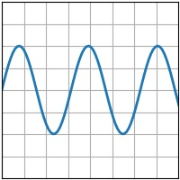
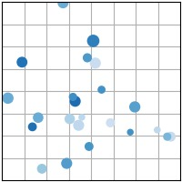
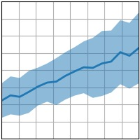
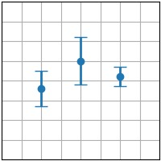
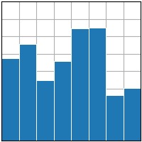

# Introduction to Matplotlib

Matplotlib is a standard for producing high-quality and interactive figures. The pyplot module is highly similar to Matlab's plotting functions, and offers an easy-to-understand, yet very powerful way to produce figures.

```{figure} matplotlib_logo.png
:label: matplotlib_logo
:width: 400px
Matplotlib logo
```


Matplotlib can generate a wide variety of plots. Here are different examples that are relevant to biomechanics, reproduced from the {{matplotlib}} website:


|              {{plt_plot}}               |              {{plt_scatter}}               | 
|:---------------------------------------:|:------------------------------------------:|
|  |  |

|              {{plt_fill_between}}               |              {{plt_imshow}}               |
|:-----------------------------------------------:|:-----------------------------------------:|
|  |  |

|              {{plt_errorbar}}               |              {{plt_bar}}               | 
|:-------------------------------------------:|:--------------------------------------:|
|  |  |

This chapter focuses solely on line plots using {{ plt_plot }}.

However, after learning this type of plot and [](../4%20Manipulating%20Arrays%20using%20Numpy/1_numpy_intro.md), any other type of plot will become relatively easy to draw just by reading their documentation.


## Importing Matplotlib

Matplotlib's `pyplot` module is very common and convenient, and is usually imported under the `plt` namespace:

```python
import matplotlib.pyplot as plt
```
