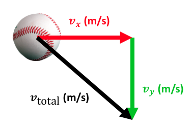

---
jupytext:
  text_representation:
    extension: .md
    format_name: myst
    format_version: 0.13
    jupytext_version: 1.14.4
kernelspec:
  display_name: Python 3 (ipykernel)
  language: python
  name: python3
---


# Arithmetics and trigonometry

This section shows how to perform mathematical operations on entire arrays.

## Arithmetics operators

All Python arithmetic operators (`+`, `-`, `*`, `/`, `**`) work directly on two NumPy arrays, assuming both arrays have the same shape. Operations are performed between corresponding elements of the same position. For example, `a + b` sums the 1st element of `a` with the 1st element of `b`, the 2nd element of `a` with the 2nd of `b`, etc.:

```{code-cell} ipython3
import numpy as np

a = np.array(
    [
        [1.0, 2.0, 3.0],
        [1.0, 2.0, 3.0],
    ]
)

b = np.array(
    [
        [1.0, 1.0, 1.0],
        [2.0, 2.0, 2.0],
    ]
)
```

**Addition**

```{code-cell} ipython3
a + b
```

**Subtraction**

```{code-cell} ipython3
a - b
```

**Multiplication**

```{code-cell} ipython3
a * b
```

**Division**

```{code-cell} ipython3
a / b
```

**Exponent**

```{code-cell} ipython3
a**b
```

**Addition with one number**

It is also possible to perform operations between an array and a single number.

```{code-cell} ipython3
a + 1
```

**Subtraction by one number**

```{code-cell} ipython3
a - 1
```

and so on.


## 💪 Exercise 1

A ball is released from a point in the air. Knowing that it was immobile when released, and that it gains negative speed at a rate of 9.81 m/s², plot its velocity as shown in [](#fig_falling_ball) release.

```{figure} fig_falling_ball.png
:label: fig_falling_ball
:width: 150px
Vertical velocity of a falling ball.
```

::::{dropdown} Tip
Start by creating a time array using {{np_arange}} or {{np_linspace}}. Then, use this time array to create a velocity array. Finally, plot the velocity as a function of time.
::::

::::{dropdown} Solution
```{code-cell} ipython3
import numpy as np
import matplotlib.pyplot as plt


# First, let's define a time array
t = np.linspace(0, 1, 100, endpoint=False)

# Calculate the velocity as -9.81 * t
v = -9.81 * t

# Show it
plt.plot(t, v)
plt.xlabel("Time (s)")
plt.ylabel("Velocity (m/s)")
plt.grid(True)
plt.show()
```
::::

## Matrix multiplication

NumPy provides the `@` operator to calculate the dot product. For instance, to calculate the dot product of two vectors:

$$
\begin{bmatrix}
1 & 2 & 3
\end{bmatrix}
\begin{bmatrix}
2 \\ 4 \\ 6
\end{bmatrix}
=
(1 * 2) + (2 * 4) + (3 * 6)
= 28
$$

you would write:

```{code-cell}
import numpy as np

a = np.array([1.0, 2.0, 3.0])
b = np.array([2.0, 4.0, 6.0])

a @ b
```

Similarly, to calculate the dot product of two matrices:

$$
\begin{bmatrix}
1 & 2 & 3 \\
4 & 5 & 6 \\
7 & 8 & 9
\end{bmatrix}
\begin{bmatrix}
1 \\ 2 \\ 3
\end{bmatrix}
$$

which is:

$$
\begin{bmatrix}
(1 * 1) + (2 * 2) + (3 * 3)\\
(4 * 1) + (5 * 2) + (6 * 3)\\
(7 * 1) + (8 * 2) + (9 * 3)
\end{bmatrix}
=
\begin{bmatrix}
14 \\ 32 \\ 50
\end{bmatrix}
$$

you write:

```{code-cell} ipython3
a = np.array(
    [
        [1.0, 2.0, 3.0],
        [4.0, 5.0, 6.0],
        [7.0, 8.0, 9.0],
    ]
)

b = np.array([1.0, 2.0, 3.0])

a @ b
```

## Trigonometry

In addition to arithmetic operators, NumPy provides lots of essential functions and constants to perform trigonometrical operations:

- {{np_pi}}: π
- {{np_sin}}: Sine
- {{np_cos}}: Cosine
- {{np_tan}}: Tangent
- {{np_arcsin}}: Arcsine
- {{np_arccos}}: Arccosine
- {{np_arctan}}: Arctangent
- {{np_arctan2}}: Arctangent in the full plane, unlike {{np_arctan}} that only returns values from -π/2 (-90°) to +π (+90°)
- {{np_deg2rad}}: Convert degrees to radians
- {{np_rad2deg}}: Convert radians to degrees
- {{np_abs}}: Absolute value
- {{np_sqrt}}: Square root

In all trigonometric functions, angles are in radians by default. You can either convert to/from degrees by multiplying or dividing by $\pi/180$ manually, or use {{np_deg2rad}} and {{np_rad2deg}}.

```{code-cell} ipython3
import numpy as np
import matplotlib.pyplot as plt

angle = np.linspace(0, 2 * np.pi, 100)

plt.plot(angle, np.sin(angle));
```

## 💪 Exercise 2

A ball is thrown horizontally with a horizontal velocity of 10 m/s and with no initial vertical velocity at release. Once released, its horizontal velocity remains constant while its vertical velocity increases negatively at a rate of 9.81 m/s². Plot a curve of its total speed for one second after release. The total speed is the magnitude (norm) of the vector created by the horizontal velocity and the vertical velocity, as shown in {numref}`fig_falling_ball_horizontal`.

:::{figure}
:label: fig_falling_ball_horizontal
:width: 3.5in


A falling ball with both horizontal and vertical velocity components.
:::


::::{dropdown} Tip
You already calculated the vertical velocity in the previous exercise. Now use the Pythagorean theorem with arithmetic operations on arrays to calculate the total speed `v_total` based on `v_x` and `v_y`.
::::

::::{dropdown} Solution
```{code-cell} ipython3
import numpy as np
import matplotlib.pyplot as plt

# First, let's define a time array
t = np.linspace(0, 1, 100, endpoint=False)

# Calculate the vertical velocity as -9.81 * t
v_y = -9.81 * t

# Constant horizontal speed of 10 m/s2
v_x = 10

# Calculate the total speed
v_total = np.sqrt(v_x**2 + v_y**2)

# Plot it
plt.plot(t, v_total)
plt.xlabel("Time (s)")
plt.ylabel("Total speed (m/s)")
plt.grid()
plt.show()
```
::::


## 💪 Exercise 3

When we walk on an inclined treadmill as in [](#fig_gait_inclined), we must overcome a backward force that is equal to:

$$
F = m g \sin \theta
$$

where $m$ is the person's mass, $g$ is 9.81 m/s² and $\theta$ is the treadmill angle. Write a function named `plot_force` that takes the mass as an argument and that plots $F$ as a function of $\theta$, for $\theta \in [-20, 20]$ degrees. Then, test your function for $m = 65$ kg.

```{figure} fig_gait_inclined.png
:label: fig_gait_inclined
:width: 300px
Walking on an inclined surface.
```

::::{dropdown} Solution
```{code-cell} ipython3
import numpy as np
import matplotlib.pyplot as plt


def plot_force(m: float) -> None:
    """
    Plot the force a person needs to overcome on an inclined treadmill.

    Parameters
    ----------
    m :
        Mass of the person in kilograms.

    Returns
    -------
    None

    """
    # First, define an angle array
    theta = np.linspace(-30, 30, 100, endpoint=False)

    # Calculate the force
    force = m * 9.81 * np.sin(np.deg2rad(theta))

    # Plot it
    plt.plot(theta, force)
    plt.xlabel("Angle (deg)")
    plt.ylabel("Force (N)")
    plt.show()


# Test the function
plot_force(65)
```
::::
