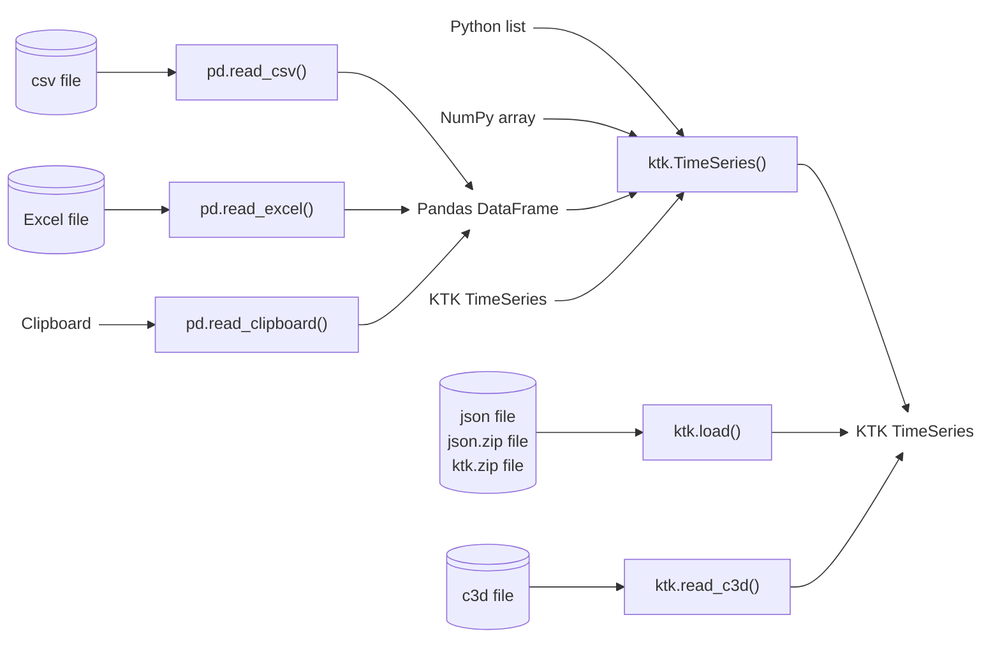

---
jupytext:
  text_representation:
    extension: .md
    format_name: myst
    format_version: 0.13
    jupytext_version: 1.14.5
kernelspec:
  display_name: Python 3 (ipykernel)
  language: python
  name: python3
---

# Importing into TimeSeries


There are many methods to create TimeSeries, either from other types or by reading files as TimeSeries. The most important ones are shown in [](#fig_importing_timeseries).

::::{figure}
:label: fig_importing_timeseries

Importing TimeSeries
::::


## Creating a TimeSeries from scratch

Since a TimeSeries is mainly a container of NumPy arrays, you may very well construct the TimeSeries manually, assigning arrays to its `time` and `data` attributes:

```{code-cell} ipython3
import kineticstoolkit.lab as ktk
import numpy as np
import pandas as pd


ts = ktk.TimeSeries()                     # Create an empty TimeSeries
ts.time = np.arange(0, 100) / 10          # Assign time
ts.data["Sinus"] = np.sin(ts.time)        # Add a data series
ts.data["Cosinus"] = np.cos(ts.time)      # Add another data series
ts.data["SquareRoot"] = np.sqrt(ts.time)  # Add yet another data series

ts.plot()
```


## 💪 Exercise

The position of an object has been recorded in metres during one second at a sampling frequency of 100 Hz:

```{code-cell} ipython3
import numpy as np

p = np.array(
    [
        0.    , 0.0099, 0.0196, 0.0291, 0.0384, 0.0475, 0.0564, 0.0651,
        0.0736, 0.0819, 0.09  , 0.0979, 0.1056, 0.1131, 0.1204, 0.1275,
        0.1344, 0.1411, 0.1476, 0.1539, 0.16  , 0.1659, 0.1716, 0.1771,
        0.1824, 0.1875, 0.1924, 0.1971, 0.2016, 0.2059, 0.21  , 0.2139,
        0.2176, 0.2211, 0.2244, 0.2275, 0.2304, 0.2331, 0.2356, 0.2379,
        0.24  , 0.2419, 0.2436, 0.2451, 0.2464, 0.2475, 0.2484, 0.2491,
        0.2496, 0.2499, 0.25  , 0.2499, 0.2496, 0.2491, 0.2484, 0.2475,
        0.2464, 0.2451, 0.2436, 0.2419, 0.24  , 0.2379, 0.2356, 0.2331,
        0.2304, 0.2275, 0.2244, 0.2211, 0.2176, 0.2139, 0.21  , 0.2059,
        0.2016, 0.1971, 0.1924, 0.1875, 0.1824, 0.1771, 0.1716, 0.1659,
        0.16  , 0.1539, 0.1476, 0.1411, 0.1344, 0.1275, 0.1204, 0.1131,
        0.1056, 0.0979, 0.09  , 0.0819, 0.0736, 0.0651, 0.0564, 0.0475,
        0.0384, 0.0291, 0.0196, 0.0099
    ]
)
```

Create a TimeSeries that contains this data and its corresponding time, so that

```
ts.plot()
```

gives this:

```{code-cell} ipython3
:tags: [remove-input]

import kineticstoolkit.lab as ktk

# Create the TimeSeries
ts = ktk.TimeSeries()

# Assign the time
ts.time = np.arange(100)/100

# Assign the position
ts = ts.add_data("Position", p)

# Add the position unit
ts = ts.add_info("Position", "Unit", "m")

ts.plot()
```

::::{dropdown} Solution
```{code-cell} ipython3
# Create the TimeSeries
ts = ktk.TimeSeries()

# Assign the time
ts.time = np.arange(100)/100

# Assign the position
ts.data["Position"] = p

# Add the position unit
ts = ts.add_info("Position", "Unit", "m")

ts.plot()
```
::::

(listarray)=
## List/Array → TimeSeries

You can create a TimeSeries directly from a list or an array. In this case, the contents will be stored with the key "data", with a matching time of one sample per second:

```{code-cell} ipython3
some_list = [
    [1., 2., 3.],
    [4., 5., 6.],
]

ktk.TimeSeries(some_list)
```

For more control on how a list or array is imported, refer to {{ktk_timeseries_from_array}}.


(dataframe)=
## DataFrame → TimeSeries

DataFrames are imported by column, where each column name becomes a data key in the resulting TimeSeries. The time is created based on the index of the DataFrame.

```{code-cell} ipython3
some_dataframe = pd.DataFrame(
    {
        "x": [1., 2., 3.],
        "y": [4., 5., 6.],
    },
    index = [0.00, 0.01, 0.02],
)

some_dataframe
```

```{code-cell} ipython3
ktk.TimeSeries(some_dataframe)
```


:::{tip}
Since Pandas can import a large number of formats to DataFrames, it is very common to first import data as a DataFrame before converting it to a TimeSeries. See section [](../4_pandas/2_pandas_importing.md) for a refresher.
:::

In the example above, both columns `x` and `y` have been imported as two unidimensional series in the resulting TimeSeries. Contrarily to DataFrames, TimeSeries can also store multidimensional data. To create such multidimensional data from the columns of a DataFrame, we use a special column naming method that is based on [indexing/slicing notation](../1_python/7_python_lists.md):

```{code-cell} ipython3
some_dataframe.columns = ["point[:,0]", "point[:,1]"]

some_dataframe
```

Importing this DataFrame combines both `point` columns into one bidimensional series:

```{code-cell} ipython3
ktk.TimeSeries(some_dataframe)
```

For more control on how a DataFrame is imported, refer to {{ktk_timeseries_from_dataframe}}.


(timeseries)=
## TimeSeries → TimeSeries

As for most types in Python, a TimeSeries is a mutable type, which means that simply writing `ts2 = ts1` does not create a second TimeSeries `ts2` based on TimeSeries `ts1`. Instead, it creates a new variable that addresses the same TimeSeries. As a consequence, modifying `ts2` would also modify `ts1`. To create an independent copy of `ts1`:

```python
ts2 = ktk.TimeSeries(ts1)
```

An alternative method is to use TimeSeries' {{ktk_timeseries_copy}} method, which provides different arguments to select which attributes to copy. For instance, to create TimeSeries with the same time and events as another one, but without its data or info:

```python
ts2 = ts.copy(copy_data=False, copy_info=False)
```

:::{note}
This same phenomenon also happens with most Python types, including NumPy arrays and Pandas DataFrames. This is why they also include a `copy` method.
:::


(json)=
## JSON → TimeSeries `(ktk.load)`

The {{ktk_load}} function reads JSON files saved by the {{ktk_save}} function. Refer to []() [](3_timeseries_exporting.md) for more information on saving and loading data, including TimeSeries, using KTK.


(c3d)=
## C3D File → TimeSeries `(ktk.read_c3d)`

We read a C3D file using {{ktk_read_c3d}}:

```{code-cell} ipython3
# Download a sample file
filename = ktk.doc.download("c3d_sample.c3d")

c3d_contents = ktk.read_c3d(filename)

c3d_contents
```

:::{caution}
As indicated in the warning above, the points in this file are expressed in millimetres; however, Kinetics Toolkit uses SI units and therefore metres by default. The point positions have been converted to metres by default, and therefore you can ignore this warning, or suppress it altogether using:

```
c3d_contents = ktk.read_c3d(filename, convert_point_unit=True)
```

You should not ignore this warning if you are reading a C3D file that has been processed by some software or pipeline to calculate joint kinetics, powers, etc., and if these values are expressed as "points" in the C3D. Consult the help of {{ktk_read_c3d}} for more details.
:::

The content of the file is expressed as a dictionary of TimeSeries.

### Points

A TimeSeries where each key is one point (marker) trajectory.

### Analogs

If present in the C3D file, a TimeSeries that contains the raw analog data from force platforms, EMG, or other analog signals recorded into the C3D file.

### ForcePlatforms

If present in the C3D file, a TimeSeries that contains the forces, moments, centres of pressure, and force platform positions.

### Quick visualization

Although visualizing data using the interactive 3D {{ktk_player}} is explained in section []() [](../7_kinematics/1_player.md), here is how we can quickly visualize the kinematic and kinetic data in this file. Note that the Player requires every input TimeSeries to have the same sampling rate, which is why we downsampled the force platform data to the points sampling rate:

```{code-cell} ipython3
:tags: [skip-execution]

ktk.Player(
    c3d_contents["Points"],
    c3d_contents["ForcePlatforms"].resample(c3d_contents["Points"].time)
)
```

```{code-cell} ipython3
:tags: [remove-input]

%matplotlib agg

points = c3d_contents["Points"].get_ts_between_times(3, 5)
ktk.Player(
    points,
    c3d_contents["ForcePlatforms"].resample(points.time)
)._to_animation()
```
