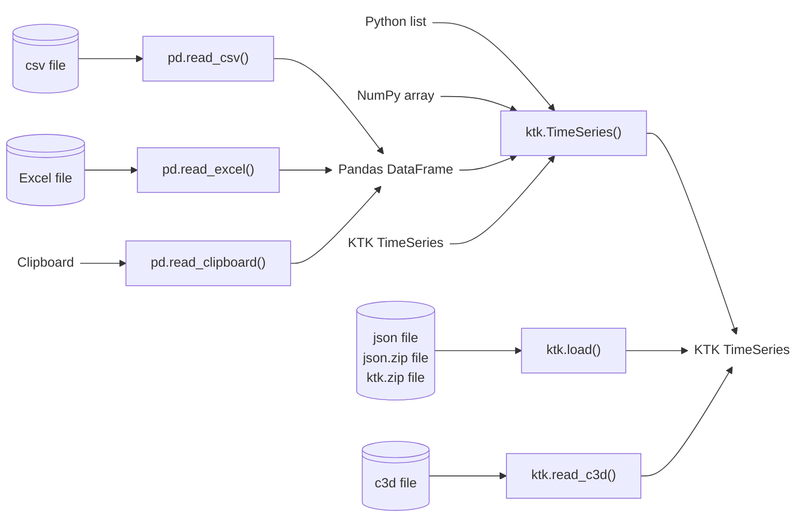

---
jupytext:
  text_representation:
    extension: .md
    format_name: myst
    format_version: 0.13
    jupytext_version: 1.14.5
kernelspec:
  display_name: Python 3 (ipykernel)
  language: python
  name: python3
---

# Importing data as a TimeSeries

There are many methods to create TimeSeries from other types, or to open different files as TimeSeries. The most important methods are shown in [](#fig_importing_timeseries).

::::{figure}
:label: fig_importing_timeseries

Importing TimeSeries
::::

(listarray)=
## List/Array → TimeSeries

Lists and arrays are imported the same way under a key named "data", with a matching time of one sample per second:

```{code-cell} ipython3
import kineticstoolkit.lab as ktk
import numpy as np
import pandas as pd


some_list = [
    [1., 2., 3.],
    [4., 5., 6.],
]

ktk.TimeSeries(some_list)
```

```{code-cell} ipython3
some_array = np.array(some_list)

ktk.TimeSeries(some_array)
```

For more control on how a list or array is imported, refer to {{ktk_timeseries_from_array}}.


(dataframe)=
## DataFrame → TimeSeries

Any file that can be read as a DataFrame can then be imported as a TimeSeries. See section [](../5%20Importing%20and%20exporting%20tabular%20data%20using%20Pandas/2_pandas_importing_dataframes.md) for a refresher on how to create DataFrames.

DataFrames are imported by column, where each column name becomes a data key in the resulting TimeSeries. The time is created based on the index of the DataFrame.

```{code-cell} ipython3
some_dataframe = pd.DataFrame(
    {
        "x": [1., 2., 3.],
        "y": [4., 5., 6.],
    },
    index = [0.00, 0.01, 0.02],
)

some_dataframe
```

```{code-cell} ipython3
ktk.TimeSeries(some_dataframe)
```

See how both columns `x` and `y` have been imported as two unidimensional series in the resulting TimeSeries.

Contrarily to DataFrames, TimeSeries can also store multidimensional data. To create such multidimensional data from columns, we use a special column naming method that is based on [indexing/slicing notation](../2%20Learning%20Python/7_python_lists):

```{code-cell} ipython3
some_dataframe = pd.DataFrame(
    {
        "point[:,0]": [1., 2., 3.],
        "point[:,1]": [4., 5., 6.],
    },
    index = [0.00, 0.01, 0.02],
)

some_dataframe
```

Now see how both columns `point[:,0]` and `point[:,1]` are imported as one bidimensional series in the resulting TimeSeries:

```{code-cell} ipython3
ktk.TimeSeries(some_dataframe)
```

For more control on how a DataFrame is imported, refer to {{ktk_timeseries_from_dataframe}}.


(timeseries)=
## TimeSeries → TimeSeries

As for most types in Python, a TimeSeries is a mutable type, which means that simply writing `ts2 = ts1` does not create a second TimeSeries `ts2` based on TimeSeries `ts1`. Instead, it creates a new variable that addresses the same TimeSeries. As a consequence, modifying `ts2` would also modify `ts1`. To create an independent copy of `ts1`, we can use:

```python
ts2 = ktk.TimeSeries(ts1)
```

An alternative method is to use TimeSeries' {{ktk_timeseries_copy}} method, which provides different arguments to select which attributes to copy. For instance, if we want to create TimeSeries with the same time and events as another one, but without its data or info, we would use:

```python
ts2 = ts.copy(copy_data=False, copy_info=False)
```

:::{note}
This same phenomenon also happens with most Python types, including NumPy arrays and Pandas DataFrames. This is why they also include a `copy` method.
:::


(c3d)=
## C3D File → TimeSeries

We read a C3D file using {{ktk_read_c3d}}:

```{code-cell} ipython3
# Download a sample file
filename = ktk.doc.download("c3d_sample.c3d")

c3d_contents = ktk.read_c3d(filename)

c3d_contents
```

:::{caution}
As indicated in the warning above, the points in this file are expressed in millimetres; however, Kinetics Toolkit uses SI units and therefore metres by default. The point positions have been converted to metres by default, and therefore you can ignore this warning, or suppress it altogether using:

```
c3d_contents = ktk.read_c3d(filename, convert_point_unit=True)
```

You should not ignore this warning if you are reading a C3D file that has been processed by some software or pipeline to calculate joint kinetics, powers, etc., and if these values are expressed as "points" in the C3D. Consult the help of {{ktk_read_c3d}} for more details.
:::

The content of the file is expressed as a dictionary of TimeSeries.

### Points

A TimeSeries where each key is one point (marker) trajectory.

### Analogs

If present in the C3D file, a TimeSeries that contains the raw analog data from force platforms, EMG, or other analog signals recorded into the C3D file.

### ForcePlatforms

If present in the C3D file, a TimeSeries that contains the forces, moments, centres of pressure, and force platform positions.

### Quick visualization

Although visualizing data using the interactive 3D {{ktk_player}} is explained in section []() [](../9%20Analyzing%203D%20Movement/1_player.md), here is how we can quickly visualize the kinematic and kinetic data in this file. Note that every TimeSeries provided to the Player must have the same sampling rate, which means we need to downsample the force platform data to the points sampling rate (or the inverse).

```{code-cell} ipython3
:tags: [skip-execution]

ktk.Player(
    c3d_contents["Points"],
    c3d_contents["ForcePlatforms"].resample(c3d_contents["Points"].time)
)
```

```{code-cell} ipython3
:tags: [remove-input]

%matplotlib qt5

points = c3d_contents["Points"].get_ts_between_times(3, 5)
ktk.Player(
    points,
    c3d_contents["ForcePlatforms"].resample(points.time)
)._to_animation()
```
