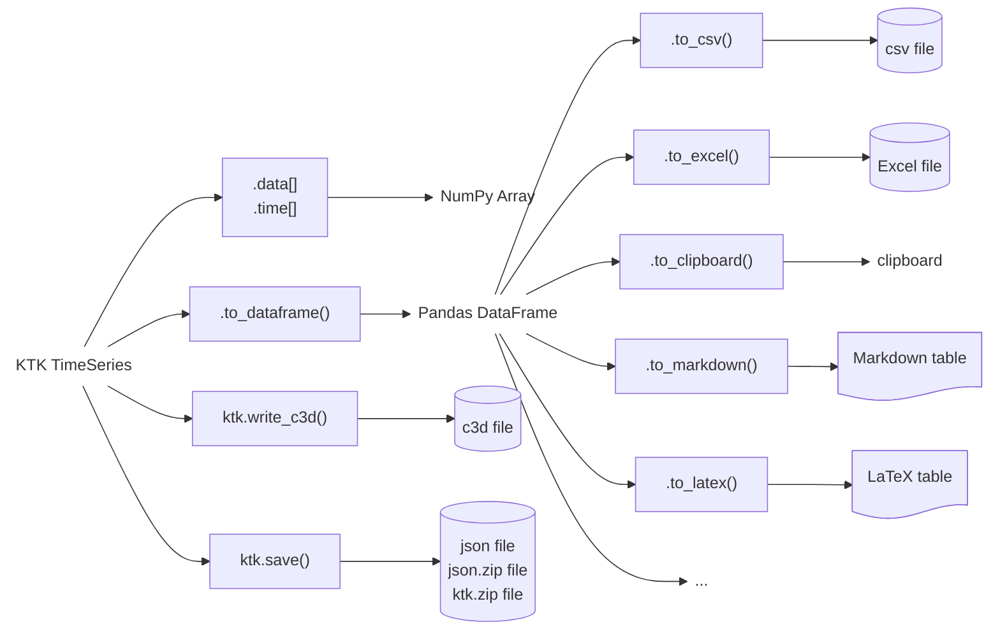

---
jupytext:
  text_representation:
    extension: .md
    format_name: myst
    format_version: 0.13
    jupytext_version: 1.14.5
kernelspec:
  display_name: Python 3 (ipykernel)
  language: python
  name: python3
---

# Exporting TimeSeries

Like for importing TimeSeries, there are several methods to export TimeSeries to other variables or files. The most important methods are shown in .

::::{figure}
:label: fig_exporting_timeseries

Exporting TimeSeries
::::