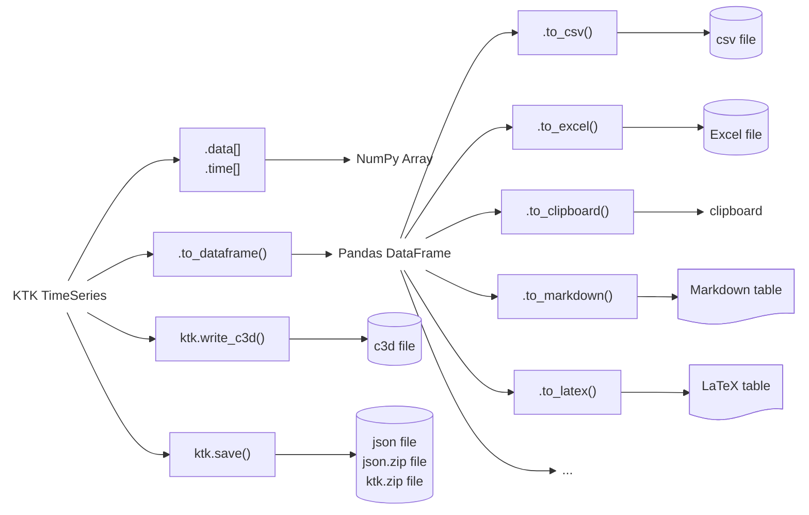

---
jupytext:
  text_representation:
    extension: .md
    format_name: myst
    format_version: 0.13
    jupytext_version: 1.14.5
kernelspec:
  display_name: Python 3 (ipykernel)
  language: python
  name: python3
---

# Exporting from TimeSeries

Like for importing TimeSeries, there are several methods to export TimeSeries to other variables or files. The most important methods are shown in [](#fig_exporting_timeseries).

::::{figure}
:label: fig_exporting_timeseries


Exporting TimeSeries
::::

(array)=
## TimeSeries → Array

To "convert" a TimeSeries to a NumPy array, simply address its `data` or `time` attributes, which already store arrays.

```{code-cell} ipython3
import kineticstoolkit.lab as ktk
import numpy as np


ts = ktk.TimeSeries(
    time = [0.0, 0.1, 0.2, 0.3, 0.4],
    data = {
        "PeakForce": [920.6690625, 929.039714 , 983.9531716, 927.0143403, 905.6627709],
        "StepLength": [0.45920416, 0.40574447, 0.42681214, 0.48090857, 0.43516921],
    }
)

# Accessing PeakForce as an array
ts.data["PeakForce"]
```


(dataframe)=
## TimeSeries → DataFrame `(TimeSeries.to_dataframe)`

To create a DataFrame based on a TimeSeries, use the {{ktk_timeseries_to_dataframe}} method:

```{code-cell} ipython3
ts.to_dataframe()
```

You can then use any of the {{pd_dataframe}} methods to export to different formats such as CSV, Excel, etc. See []() [](../5_pandas/3_pandas_exporting.md) for a refresher.


(c3d)=
## TimeSeries → C3D `(ktk.write_c3d)`

Use {{ktk_write_c3d}} to create a new C3D file based on point trajectories or series of analog data. In this example, suppose that we forgot to zero the force plates before recording, and our workflow requires that the input C3D file has zeroed vertical forces. We will open this C3D file, correct the analog signals, and then save a new C3D file.

```{code-cell} ipython3
filename = ktk.doc.download("c3d_test_suite_sample.c3d")
c3d_contents = ktk.read_c3d(filename, convert_point_unit=True)

points = c3d_contents["Points"]
analogs = c3d_contents["Analogs"]
```

Let's take a look at the forces:

```{code-cell} ipython3
analogs.plot(["FZ1", "FZ2"])
```

There are some offsets in these signals that could be corrected by subtracting the median of the signal:

```{code-cell} ipython3
analogs.data["FZ1"] -= np.median(analogs.data["FZ1"])
analogs.data["FZ2"] -= np.median(analogs.data["FZ2"])

analogs.plot(["FZ1", "FZ2"])
```

We now use {{ktk_write_c3d}} to save these corrected data as a new C3D file:

```{code-cell} ipython3
ktk.write_c3d("corrected.c3d", points=points, analogs=analogs)
```


(json)=
## TimeSeries → JSON `(ktk.save)`

Contrarily to Matlab's MAT file, Python does not come with a single standard way to save data. To ease saving and sharing data, Kinetics Toolkit provides two functions to load and save data, including TimeSeries, as a JSON file:

- {{ktk_save}}
- {{ktk_load}}

These functions preserve data in both directions, which means that anything that is saved using {{ktk_save}} is guaranteed to load back using {{ktk_load}}[^1].  To save a variable:

[^1]: Except tuples that are loaded back as lists, following Python's standard behaviour.


```python
ktk.save(filename, variable)
```

To load a variable:

```python
variable = ktk.load(filename)
```


### Supported types

All these types are supported, not only TimeSeries.

| Already supported by JSON          | Extended for KTK  |
| ---------------------------------- | ----------------- |
| dict containing any supported type | NumPy arrays      |
| list containing any supported type | Pandas DataFrames |
| str                                | Pandas Series     |
| int                                | KTK TimeSeries    | 
| float                              |                   |
| True, False, None                  |                   |

